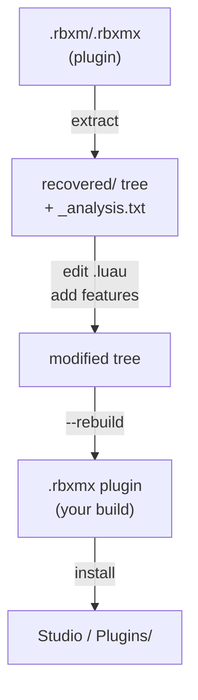

# PluginReaper

> Reverse engineer any Roblox plugin. Edit the source. Ship it back as a plugin.

PluginReaper turns a `.rbxm` / `.rbxmx` plugin into a clean developer folder tree, analyzes it, lets you search and modify it, then rebuilds a Studio-loadable plugin. Built for developers who like a plugin but wish it had one more feature — get the source, change it, put it back.

---

## Why this exists

You install a plugin. It’s close to perfect, but not quite. You want:

- a missing hotkey
- a cleaner UI flow
- a fix for a bug the author never shipped
- to learn how a complex tool is structured

Studio does not hand you the source. Protected / compiled plugins only expose bytecode. PluginReaper closes that gap:

- Extract full hierarchy + script sources (XML and binary).
- Analyze entry points, requires, services, risk flags.
- Search / scan the tree for anything interesting.
- Edit the `.luau` files like a normal project.
- Rebuild a `.rbxmx` you can install or publish.

> **No network calls.** Everything stays on your machine.

## Install

```powershell
# from the PluginReaper folder

pip install -r requirements.txt
```

> **Optional (recommended for compressed binary plugins):** `pip install zstandard lz4`
>
> **Optional (full bytecode → source recovery):** drop a Luau decompiler binary (`luau-decompiler`, Oracle, etc.) into `tools/` or on your `PATH`.
>
> **Requirements:** Python 3.10+

## Quick start

```powershell
# 1) Extract a plugin (XML or binary)
python .\plugin_reaper.py "C:\path\to\Eclipse Animator.rbxmx" -o .\recovered --clean --beautify

# 2) Read the analysis
notepad .\recovered_analysis.txt

# 3) Edit any .luau file under .\recovered\

# 4) Rebuild into a new plugin
python .\plugin_reaper.py --rebuild .\recovered -o .\EclipseAnimator_modded.rbxmx

# 5) Install

# Copy EclipseAnimator_modded.rbxmx into:
# %LOCALAPPDATA%\Roblox\Plugins\

# Restart Studio, or use right-click → Save as Local Plugin / Publish as Plugin
```

## Commands

| Command | Purpose |
| --- | --- |
| <code>python plugin_reaper.py &lt;file.rbxm&#124;rbxmx&gt; -o ./out</code> | Extract plugin → clean source tree |
| `--clean` | Wipe output folder before extract |
| `--beautify` | Strip extraction headers, normalize whitespace |
| `--decompile` | Attempt bytecode recovery (needs external decompiler for full source) |
| `--from-id <assetId>` | Extract from local InstalledPlugins cache |
| `--list-installed` | List plugins already cached by Studio |
| `--rebuild ./recovered -o ./out.rbxmx` | Turn edited tree back into a loadable plugin |
| `--scan ./recovered` | Security / behavior pattern scan |
| `--search ./recovered "query"` | Full-text search |
| <code>--search ./recovered "HttpService&#124;loadstring" --regex</code> | Regex search |

## Extract examples

```powershell
python .\plugin_reaper.py ".\MyPlugin.rbxm" -o .\out --clean --beautify
python .\plugin_reaper.py ".\MyPlugin.rbxmx" -o .\out --clean
python .\plugin_reaper.py --from-id 1234567890 -o .\that_plugin
```

## Rebuild example

```powershell
python .\plugin_reaper.py --rebuild .\out -o .\MyPlugin_v2.rbxmx
```

## Search / scan examples

```powershell
python .\plugin_reaper.py --scan .\out
python .\plugin_reaper.py --search .\out "loadstring"
python .\plugin_reaper.py --search .\out "FireServer|InvokeServer" --regex
python .\plugin_reaper.py --search .\out "plugin:CreateToolbar"
```

## Output layout

After a successful extract:

```text
recovered/
├── <PluginRoot>/ # original hierarchy
│   ├── init.server.luau # root Script (if it had children)
│   ├── container/
│   │   └── core/
│   │       ├── launcher.luau
│   │       └── ...
│   └── ...
├── _plugin_meta.json # instance counts, format, metadata
├── _extraction_summary.txt # extract stats
├── _analysis.txt # entry points, risk, require graph (human)
├── _analysis.json # same data (machine-readable)
├── _script_index.csv # every script path + line count
├── default.project.json # Rojo project scaffold
└── README_RECOVERED.md # short notes for the recovered tree
```

After `--scan`:

```text
└── _scan_results.json # HTTP, loadstring, remotes, etc.
```

## Script naming

| File suffix | Roblox class |
| --- | --- |
| `.server.luau` | Script |
| `.client.luau` | LocalScript |
| `.luau` | ModuleScript |
| `.core.luau` | CoreScript |

Folders keep structure. Scripts that contained children in the original plugin become a folder with `init.*.luau` plus nested modules — so `require(script.container.core.launcher)` still makes sense after extract and after rebuild.

## Full developer loop



1. Extract the plugin you care about.
2. Open `_analysis.txt` — see entry points and anything flagged.
3. Change the sources (new toolbar button, fix, refactor).
4. Rebuild.
5. Drop the new `.rbxmx` into your Plugins folder or publish it as your own local/private plugin.

This is the “I like this plugin but I wish it had X” workflow.

## Analysis (`_analysis.txt`)

Every extract runs a deep pass over all scripts:

- **Entry points** — names like init / launcher / main, root Scripts, Plugin API usage
- **Require graph** — who requires whom (sample)
- **Service usage** — `GetService("...")` frequency
- **Risk / behavior flags**

| Flag | Meaning |
| --- | --- |
| HTTP | `HttpService` / `RequestAsync` / `HttpGet`-style usage |
| LOADSTRING | Dynamic code execution |
| ENV_TAMPER | `getfenv` / `setfenv` / metatable tricks |
| REMOTE | `RemoteEvent` / `FireServer` / `OnServerEvent`, etc. |
| OBFUSC_HEX / OBFUSC_STRINGS / OBFUSC_NUMTABLE | Obfuscation signals |
| MINIFIED | Very long lines / dense code |
| PLUGIN_API | Normal plugin toolbar / dock widget APIs |
| NO_SOURCE | Bytecode-only or empty |

High-risk scripts (score ≥ 40) are listed first so you can inspect them before trusting or shipping a rebuild.

## Pattern scan (`--scan`)

One-shot pass for common behaviors:

- HTTP / loadstring / getfenv
- Remotes (FireServer, InvokeServer, …)
- Marketplace / purchase prompts
- TeleportService
- DataStore
- plugin:SetSetting / GetSetting

Results land in `_scan_results.json` and are printed to the console.

## Rebuild details

`--rebuild` walks the extracted tree and emits a valid Roblox XML model (`.rbxmx`):

- Respects `.server.luau` / `.client.luau` / `.luau` suffixes
- Uses `_instance.json` when present (class + name from original extract)
- Root Script + children → single Script item with nested Items
- Source written as ProtectedString with CDATA (handles `]]>` safely)
- Skips meta files (`_analysis.*`, `_plugin_meta.json`, Rojo files, etc.)

### Install options

**Local Plugins folder**

```text
%LOCALAPPDATA%\Roblox\Plugins\
```

Restart Studio (or refresh plugins).

**From Studio**

Insert the `.rbxmx` into a place → right-click the root → Save as Local Plugin or Publish as Plugin.

**Rojo**

Use `default.project.json` if you prefer a Rojo serve/sync workflow while editing.

## Finding plugins on disk

| Location | Path (Windows) |
| --- | --- |
| Installed from Creator Store | `%LOCALAPPDATA%\Roblox\<UserId>\InstalledPlugins\<AssetId>\<Version>\Plugin.rbxm` |
| Local plugins | `%LOCALAPPDATA%\Roblox\Plugins\` |
| Built-in Studio plugins | `%LOCALAPPDATA%\Roblox\Versions\<version>\BuiltInPlugins\` |

```powershell
python .\plugin_reaper.py --list-installed
```

If the plugin is already installed in Studio, `--from-id <assetId>` pulls it from the cache without hunting paths.

## Project structure

```text
PluginReaper/
├── plugin_reaper.py # CLI entry
├── requirements.txt
├── README.md
├── core/
│   ├── rbxm_parser.py # Binary .rbxm parser
│   ├── rbxmx_parser.py # XML .rbxmx parser
│   ├── extractor.py # Hierarchy → folders + .luau
│   ├── analyzer.py # Entry points, risk, require graph
│   ├── search.py # Full-text + pattern scan
│   ├── decompiler.py # Bytecode recovery bridge
│   ├── rebuild.py # Tree → .rbxmx plugin
│   ├── project_gen.py # Rojo + script index
│   └── prettier.py # Source cleanup
├── utils/
│   └── paths.py # Studio cache path helpers
├── tools/ # Optional: place external decompilers here
└── docs/
    └── ARCHITECTURE.md
```

## Formats supported

| Input | Support |
| --- | --- |
| `.rbxmx` (XML) | Native — full Source / ProtectedString / hierarchy |
| `.rbxm` (binary) | Native — INST / PROP / PRNT, LZ4 + ZSTD when libs installed |
| Compiled / Source stripped | Hierarchy always; bytecode saved as `.bc`; recovery via `--decompile` + external tool |

Auto-detection: if the file starts with `<` / `<roblox`, XML path is used; if `<roblox!`, binary path is used.

## Tips

- Always open `_analysis.txt` before editing a large plugin (hundreds of scripts).
- Use `--scan` before you rebuild and install anything you did not author.
- Prefer `--beautify` on extract so diffs and edits are cleaner.
- Keep a copy of the original `.rbxmx` / `.rbxm` so you can re-extract if a rebuild needs a fresh base.
- For binary plugins that only ship bytecode, install a real Luau decompiler under `tools/` and re-run with `--decompile` for better recovery.

## Limitations

- Rebuild targets XML `.rbxmx` (Studio accepts it as a plugin). Binary `.rbxm` write is not implemented.
- Complex non-script properties (CFrames, full UI trees, meshes) are not fully re-serialized from the folder tree; the rebuild path is optimized for script-centric plugins (the common case for tools you want to modify).
- Bytecode decompilation quality depends on the external tool you provide; without one, PluginReaper writes inspection reports, not full source.
- Does not execute plugin code. Safe offline inspection only.

## License / intent

PluginReaper is a local reverse-engineering and development aid. Use it on plugins you own, have installed, or have the right to study. The extract → edit → rebuild loop is for learning and improving tools in your own workflow — not for redistributing someone else’s work as your own without permission.

---

*PluginReaper v2 — extract, understand, improve, ship.*
